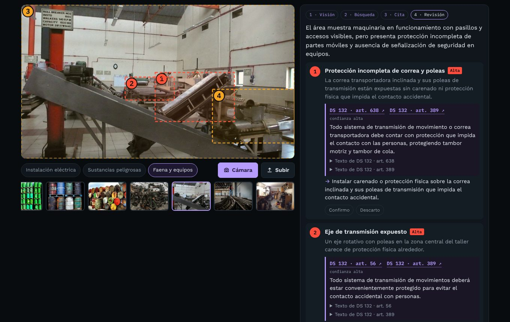
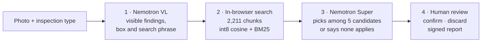

# Compliance supervisor

**Take a photo of a site and every finding comes with the article that requires it, from Chilean regulations DS 594, DS 132, DS 43 or the RIC electrical code, linked to the official text. A person confirms or discards each one before signing.**

[](https://jsnn15.github.io/supervisor/)


[Español](README.md) · **English**

<a href="https://jsnn15.github.io/supervisor/"></a>

## The problem

A safety inspection ends in a list of observations. The slow part comes next: finding which article requires each item, so the observation carries weight with management, a contractor or an inspector. A language model alone does this quickly, and confidently invents article numbers.

This machine splits the work: **the AI looks, a search engine finds the regulation, and the model may only cite what the search found.**

## How it works



1. **Vision.** Nemotron Super VL gets the photo and the inspection type. It returns findings with their location, what looks fine, and what the photo cannot verify. It cannot cite regulations at this stage.
2. **Search.** Each finding carries a phrase written the way a regulation would say it. It is embedded with Nemotron Embed and searched in the browser against the articles for that inspection type: semantic similarity plus BM25, fused by reciprocal rank, at most 3 candidates per regulation.
3. **Citation.** Nemotron Super gets each finding with its 5 candidates and picks up to two, with the requirement and the corrective action. The browser drops any id that was not among the candidates. If nothing applies, the finding is marked "no direct article" and the reviewed ones are listed.
4. **Review.** Each finding is confirmed or discarded. The report states who reviewed it; with no name or pending findings it is marked **draft**. It prints or downloads as JSON.

| Inspection type | Regulations searched |
|---|---|
| Electrical installation | RIC sheets 1–19 (SEC), DS 594, DS 132 |
| Hazardous substances | DS 43, DS 594 |
| Mine site and equipment | DS 132, DS 594 |

## Evaluation

The 11 sample photos produced 49 findings. Each citation was checked by hand against the article text:

| Direct citation | Partial or generic | Wrong | No citation |
|---|---|---|---|
| 31 (69%) | 11 (24%) | 3 (7%) | 4 |

Per-finding detail and what to improve are in [evaluacion.md](evaluacion.md) (Spanish). It is a first measurement on few photos, not yet validated by a safety professional: it guides the work, it is not a performance claim.

## Built to be used for real

- **Conditions, not people.** The model is told not to identify people or infer emotions; only the visible unsafe condition matters. The photo is downscaled on the device, goes through a gateway and is not stored. This follows Chile's data protection law (Ley 21.719) and the AI bill, which bans emotion inference at work.
- **Mandatory human oversight.** Nothing becomes a final report without a name and a decision on every finding.
- **What a photo cannot tell**, always stated: earthing, noise or silica measurements, safety data sheets, stored quantities, permits and training.
- **Official texts.** Decrees come from LeyChile's XML service with a per-article link; RIC sheets from the [RIC Lookup](https://github.com/JSNN15/normativa) index with a link to the SEC PDF page.

## Limits

- A photo is one moment and one angle. A correct citation does not prove non-compliance; an on-site inspection does.
- DS 132 governs mining operations; outside mining its articles are a technical reference, not an obligation.
- Client-specific standards are not loaded yet. That is the natural next layer.
- It does not replace a safety professional or a licensed electrician.

## Files

| File | What it is |
|---|---|
| `index.html` | UI, hybrid search, citation validation, review and report. |
| `samples.js` | Sample photos with the saved result of this same pipeline. |
| `s/normas.json`, `s/vec.bin` | 1,116 chunks of DS 594, DS 132 and DS 43 with LeyChile links, and their int8 vectors. |
| `tools/descargar.sh` | Downloads the current decrees from LeyChile. |
| `tools/chunk.py` | Splits by article with title and section as context; skips repealed ones. |
| `tools/embed.py` | Embeds with Nemotron Embed (needs `NVIDIA_API_KEY`) and quantizes to int8. |

```bash
./tools/descargar.sh && python3 tools/chunk.py && NVIDIA_API_KEY=... python3 tools/embed.py
```

NVIDIA calls go through [nv-gateway](https://github.com/JSNN15/nv-gateway) (`/supervisa`, `/embed` and `/cita` routes); the key never reaches the browser.

---

Servicio y Soluciones Tecnológicas DelaCruz SpA · [Julián Neira Nova](https://www.linkedin.com/in/julian-neira-nova/) · [Portfolio](https://jsnn15.github.io/)
