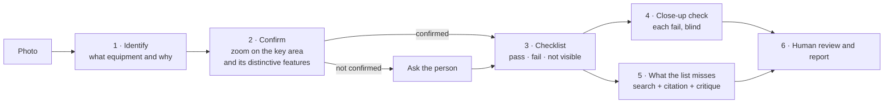

# Compliance supervisor

**One photo of a site. The machine identifies the equipment, confirms it up close and checks it against that equipment's checklist, each item with its article from Chilean regulations (RIC electrical code, DS 594, DS 132, DS 43) assigned in advance. A person confirms or discards each finding before signing.**

[Español](README.md) · **English**

## The problem

An inspection ends in observations; the slow part is finding which article requires each one. A language model alone does it fast and invents articles. And if you tell it what to look for, it finds it even when it is not there: it asks a utility meter for a panel door.

## How it works

1. **Identify.** Nemotron Super VL picks the equipment from a closed list, with evidence, rejected alternatives, confidence and the key area. Nobody tells it what to expect. Low confidence triggers a second pass with reasoning on.
2. **Confirm.** The key area is cropped and enlarged, and the model is asked about features specific to that equipment. A rule decides, not the model: at least 2 features visible and a subtype that does not name another equipment. Otherwise the page asks the person.
3. **Checklist.** Each item is *pass*, *fail* or *not visible*, with its location, using the full photo and the close-up. The model cannot cite: **each item's article was assigned by a person** in `s/listas.json`.
4. **Close-up check.** Each fail is cropped and asked again without the previous answer. If the close-up does not hold, it is downgraded and noted.
5. **What the list misses.** Up to 3 extra findings go through in-browser search over 2,211 regulation chunks, citation choice among the results, and a critique pass that drops citations that do not require what was observed.
6. **Human review.** Confirm or discard each finding; without a name or with pending items the report is a **draft**.

Every model answer uses a strict JSON schema (`response_format`) and is retried on API errors.

## Checklists

| Equipment | Items | Regulations |
|---|---|---|
| Meter and service connection | 10 (2 only for grouped meters) | RIC N°1, utility standard |
| Electrical panel | 11 | RIC N°2 |
| Hazardous substances | 9 | DS 43, DS 594 |
| Belt conveyor | 8 | DS 594; DS 132 binding in mining, reference elsewhere |

## Evaluation

On 13 sample photos ([detail, Spanish](evaluacion.md)): identification right first time in 11; both errors were caught by confirmation, which asked; none reached the checklist unasked. Of 105 checklist items, 70 were "not visible", the honest answer for a photo; 5 of 29 fails were downgraded on the close-up. Expert review of each fail is pending.

## Limits

- One photo is one moment and one angle; most items of a meter or a panel are not visible in a photo, and the machine says so.
- The model still varies between runs on small details; the close-up and blind check reduce it, they do not remove it.
- Not a replacement for a licensed electrician or a safety professional.

NVIDIA calls go through [nv-gateway](https://github.com/JSNN15/nv-gateway); the key never reaches the browser.

---

Servicio y Soluciones Tecnológicas DelaCruz SpA · [Julián Neira Nova](https://www.linkedin.com/in/julian-neira-nova/) · [Portfolio](https://jsnn15.github.io/)
