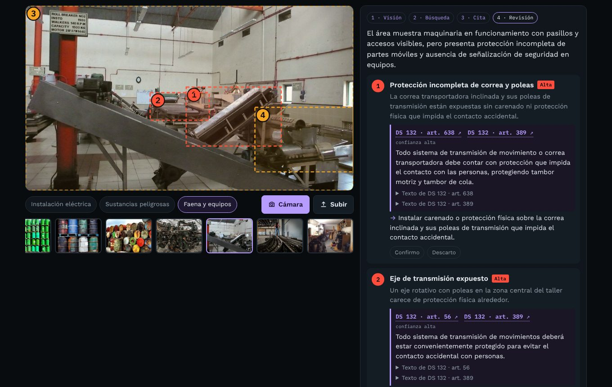
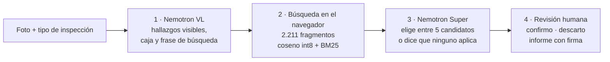

# Supervisor normativo

**Una foto de la instalación y cada hallazgo llega con el artículo que lo exige: DS 594, DS 132, DS 43 o pliego RIC, con enlace al texto oficial. Una persona confirma o descarta antes de firmar.**

[](https://jsnn15.github.io/supervisor/)


**Español** · [English](README.en.md)

<a href="https://jsnn15.github.io/supervisor/"></a>

## El problema

Una inspección de seguridad termina en una lista de observaciones. La parte lenta es la que viene después: encontrar qué artículo exige cada cosa, para que la observación tenga peso frente a la jefatura, el contratista o una fiscalización. Un modelo de lenguaje solo lo hace rápido, pero inventa números de artículo con total seguridad.

Esta máquina separa las dos tareas: **la IA mira, un buscador encuentra la norma y el modelo solo puede citar lo que el buscador encontró.**

## Cómo funciona



1. **Visión.** Nemotron Super VL recibe la foto y el tipo de inspección. Devuelve hallazgos con su ubicación, lo que se ve bien y lo que la foto no permite verificar. No puede citar normas en esta etapa.
2. **Búsqueda.** Cada hallazgo trae una frase redactada como la diría un reglamento. Se vectoriza con Nemotron Embed y se busca en el navegador contra los artículos del tipo de inspección: similitud semántica más BM25, fusionadas por rango recíproco, máximo 3 candidatos por norma.
3. **Cita.** Nemotron Super recibe cada hallazgo con sus 5 candidatos y elige hasta dos, con la exigencia y la acción. El navegador descarta cualquier id que no estuviera entre los candidatos. Si nada aplica, el hallazgo queda "sin artículo directo" y se muestran los revisados.
4. **Revisión.** Cada hallazgo se confirma o descarta. El informe dice quién lo revisó; si falta el nombre o hay hallazgos pendientes, sale marcado como **borrador**. Se imprime o se descarga en JSON.

| Tipo de inspección | Normas que se buscan |
|---|---|
| Instalación eléctrica | Pliegos RIC 1–19 (SEC), DS 594, DS 132 |
| Sustancias peligrosas | DS 43, DS 594 |
| Faena y equipos | DS 132, DS 594 |

## Evaluación

En las 11 fotos de ejemplo salieron 49 hallazgos. Cada cita se revisó a mano contra el texto del artículo:

| Cita directa | Parcial o general | No corresponde | Sin cita |
|---|---|---|---|
| 31 (69 %) | 11 (24 %) | 3 (7 %) | 4 |

El detalle hallazgo por hallazgo y lo que hay que mejorar está en [evaluacion.md](evaluacion.md). Es una primera medición, con pocas fotos y sin validación de un experto en prevención: sirve para dirigir el trabajo, no como cifra de desempeño.

## Diseño para usarlo en serio

- **Condiciones, no personas.** El modelo tiene instrucción de no identificar personas ni inferir estados de ánimo; de una persona solo importa la condición insegura visible. La foto se reduce en el equipo, pasa por un intermediario y no se guarda. Va en línea con la Ley 21.719 de datos personales y con el proyecto de ley de IA, que prohíbe inferir emociones en el trabajo.
- **Supervisión humana obligatoria.** Nada sale como informe final sin nombre y sin revisar cada hallazgo.
- **Lo que una foto no puede decir**, dicho siempre: mediciones de puesta a tierra, ruido o sílice, hojas de datos de seguridad, cantidades almacenadas, permisos y capacitación.
- **Textos oficiales.** Los decretos vienen del servicio XML de LeyChile con su enlace por artículo; los pliegos RIC, del índice de [Consulta RIC](https://github.com/JSNN15/normativa) con enlace a la página del PDF de la SEC.

## Límites

- Una foto muestra un momento y un ángulo. Una cita correcta no prueba un incumplimiento: lo prueba la inspección en terreno.
- El DS 132 rige faenas mineras; en una industria que no es minera, sus artículos sirven como referencia técnica, no como obligación.
- Las normas internas del mandante (estándares de la minera, reglas de oro) no están cargadas. Es la siguiente capa natural.
- No reemplaza al experto en prevención de riesgos ni al instalador autorizado.

## Archivos

| Archivo | Qué es |
|---|---|
| `index.html` | Interfaz, búsqueda híbrida, validación de citas, revisión e informe. |
| `samples.js` | Fotos de ejemplo con el resultado guardado de este mismo flujo. |
| `s/normas.json`, `s/vec.bin` | 1.116 fragmentos de DS 594, DS 132 y DS 43 con su enlace a LeyChile, y sus vectores int8. |
| `tools/descargar.sh` | Descarga los decretos vigentes desde LeyChile. |
| `tools/chunk.py` | Corta por artículo con título y párrafo como contexto; deja fuera los derogados. |
| `tools/embed.py` | Vectoriza con Nemotron Embed (necesita `NVIDIA_API_KEY`) y cuantiza a int8. |
| `evaluacion.md` | Revisión de cada cita de los ejemplos. |

```bash
./tools/descargar.sh && python3 tools/chunk.py && NVIDIA_API_KEY=... python3 tools/embed.py
```

Las llamadas a NVIDIA pasan por [nv-gateway](https://github.com/JSNN15/nv-gateway) (rutas `/supervisa`, `/embed` y `/cita`); la clave nunca llega al navegador.

## Fuentes

- [DS 594](https://www.bcn.cl/leychile/navegar?idNorma=167766), [DS 132](https://www.bcn.cl/leychile/navegar?idNorma=221064) y [DS 43](https://www.bcn.cl/leychile/navegar?idNorma=1088802), texto vigente desde LeyChile (Biblioteca del Congreso Nacional).
- Pliegos técnicos RIC N°1 a 19, Superintendencia de Electricidad y Combustibles.
- Fotos de ejemplo de Flickr con licencia Creative Commons; créditos al pie de la página.

---

Servicio y Soluciones Tecnológicas DelaCruz SpA · [Julián Neira Nova](https://www.linkedin.com/in/julian-neira-nova/) · [Portafolio](https://jsnn15.github.io/)
