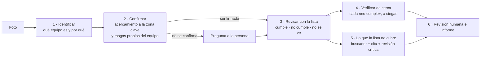

# Supervisor normativo

**Una foto de la instalación. La máquina identifica el equipo, lo confirma de cerca y lo revisa contra su lista de puntos, cada uno con el artículo del RIC, DS 594, DS 132 o DS 43 ya asignado. Una persona confirma o descarta antes de firmar.**

[](https://jsnn15.github.io/supervisor/)


**Español** · [English](README.en.md)

<a href="https://jsnn15.github.io/supervisor/"></a>

## El problema

Una inspección termina en observaciones, y lo lento es encontrar qué artículo exige cada una. Un modelo de lenguaje solo lo hace rápido, pero inventa artículos. Y si se le dice de antemano qué buscar, lo encuentra aunque no esté: a un medidor de la distribuidora le pide tapa de tablero.

## Cómo funciona



1. **Identificar.** Nemotron Super VL elige el equipo de una lista cerrada (medidor y empalme, tablero, sala eléctrica, sustancias peligrosas, correa, máquina…), con evidencia, alternativas descartadas, confianza y la zona clave de la foto. Nadie le dice qué esperar. Si la confianza es baja, repite con razonamiento activado.
2. **Confirmar.** Se recorta y amplía la zona clave y se pregunta por los rasgos propios de ese equipo: visor de kWh y sello en un medidor, automáticos y barras en un tablero. La confirmación la decide una regla, no el modelo: al menos 2 rasgos a la vista y un subtipo que no nombre otro equipo. Si no se cumple, la página pregunta qué muestra la foto.
3. **Revisar con la lista.** Cada punto queda en *cumple*, *no cumple* o *no se ve*, con su ubicación. El modelo recibe la foto completa y el acercamiento. No puede citar: **el artículo de cada punto lo asignó una persona** en `s/listas.json`.
4. **Verificar de cerca.** Cada «no cumple» se recorta y se vuelve a preguntar sin mostrar la respuesta anterior. Si el acercamiento no lo sostiene, baja de estado y queda anotado.
5. **Lo que la lista no cubre.** Hasta 3 hallazgos extra pasan por el buscador (2.211 fragmentos de LeyChile y RIC, coseno int8 + BM25 en el navegador), la elección de cita entre lo encontrado y una revisión crítica que descarta citas que no exigen lo observado.
6. **Revisión humana.** Confirmo o descarto por hallazgo; sin nombre o con pendientes, el informe sale como **borrador**. Se imprime o se descarga en JSON.

Todas las respuestas del modelo salen con esquema JSON estricto (`response_format`), con reintento ante errores de la API.

## Listas de revisión

| Equipo | Puntos | Normas |
|---|---|---|
| Medidor y empalme | 10 (2 solo para empalmes concentrados) | RIC N°1, estándar de la distribuidora |
| Tablero eléctrico | 11 | RIC N°2 |
| Sustancias peligrosas | 9 | DS 43, DS 594 |
| Correa transportadora | 8 | DS 594; DS 132 como obligación en faena minera y referencia fuera de ella |

Cada punto trae severidad, quién corrige (cliente, distribuidora o administración, en el caso del empalme) y el texto del artículo. Cada equipo trae también lo que **siempre** requiere terreno o documento: capacidad del empalme, curva del limitador, inscripción en la SEC, hojas de seguridad, prueba de la parada de emergencia. Los equipos sin lista (sala eléctrica, transformador, máquina, área de trabajo…) pasan directo a la etapa 5.

## Evaluación

En 13 fotos de ejemplo ([detalle](evaluacion.md)):

- **Identificación:** 11 de 13 correctas a la primera. Los 2 errores (una caja de fusibles tomada por medidor y una correa tomada por máquina) los detectó la confirmación y preguntó. Ningún error llegó a la revisión sin pregunta.
- **Lista:** 105 puntos revisados; 70 quedaron en «no se ve», que es lo honesto para una foto. De 29 «no cumple» mirados de cerca, 5 bajaron de estado.
- **Pendiente:** la revisión experta de cada «no cumple», punto por punto.

## Diseño para usarlo en serio

- **Condiciones, no personas.** No identifica personas ni infiere estados de ánimo; de una persona solo importa la condición insegura visible. La foto no se guarda. En línea con la Ley 21.719 y el proyecto de ley de IA.
- **El criterio técnico es explícito y versionado.** Las listas viven en un archivo que un experto revisa y corrige, no dentro de un prompt.
- **Supervisión humana obligatoria** antes del informe final.

## Límites

- Una foto muestra un momento y un ángulo; la mayoría de los puntos de un empalme o un tablero no se ven en una foto, y la máquina lo dice.
- El modelo sigue variando entre corridas en detalles chicos; el acercamiento y la verificación ciega lo reducen, no lo eliminan.
- Faltan listas para sala eléctrica, transformador, cilindros y estanques, y los estándares de empalme de cada distribuidora.
- No reemplaza al instalador autorizado ni al experto en prevención de riesgos.

## Archivos

| Archivo | Qué es |
|---|---|
| `index.html` | Interfaz y pipeline: recortes, reglas de confirmación, verificación, búsqueda, revisión e informe. |
| `s/listas.json` | Equipos, rasgos para confirmar, listas de revisión con artículo, severidad y texto. |
| `samples.js` | Fotos de ejemplo con el resultado guardado de este mismo flujo. |
| `s/normas.json`, `s/vec.bin` | 1.116 fragmentos de DS 594, DS 132 y DS 43 con su enlace a LeyChile, y sus vectores int8. |
| `tools/listas.py` | Arma `s/listas.json` sacando el texto exacto de cada artículo. |
| `tools/descargar.sh`, `tools/chunk.py`, `tools/embed.py` | Descargan los decretos desde LeyChile, los cortan por artículo y los vectorizan. |
| `evaluacion.md` | Mediciones de la versión 2 y de la versión 1. |
| `tools/medir.py` | Recalcula las cifras de `evaluacion.md` contando sobre los ejemplos guardados. `python3 tools/medir.py` |

```bash
./tools/descargar.sh && python3 tools/chunk.py && NVIDIA_API_KEY=... python3 tools/embed.py && python3 tools/listas.py
```

Las llamadas a NVIDIA pasan por [nv-gateway](https://github.com/JSNN15/nv-gateway) (rutas `/identifica`, `/confirma`, `/revisa`, `/verifica`, `/embed`, `/cita` y `/critica`); la clave nunca llega al navegador.

## Fuentes

- [DS 594](https://www.bcn.cl/leychile/navegar?idNorma=167766), [DS 132](https://www.bcn.cl/leychile/navegar?idNorma=221064) y [DS 43](https://www.bcn.cl/leychile/navegar?idNorma=1088802), texto vigente desde LeyChile.
- [RIC N°1 Empalmes](https://www.sec.cl/sitio-web/wp-content/uploads/2021/01/RIC-N01-Empalmes.pdf) y pliegos técnicos RIC N°2 a 19, Superintendencia de Electricidad y Combustibles.
- Acercamiento a la zona que el modelo señala: Zhang et al., [*MLLMs Know Where to Look*](https://arxiv.org/abs/2502.17422), ICLR 2025.
- Fotos de ejemplo de Flickr con licencia Creative Commons; créditos al pie de la página.

---

Servicio y Soluciones Tecnológicas DelaCruz SpA · [Julián Neira Nova](https://www.linkedin.com/in/julian-neira-nova/) · [Portafolio](https://jsnn15.github.io/)
